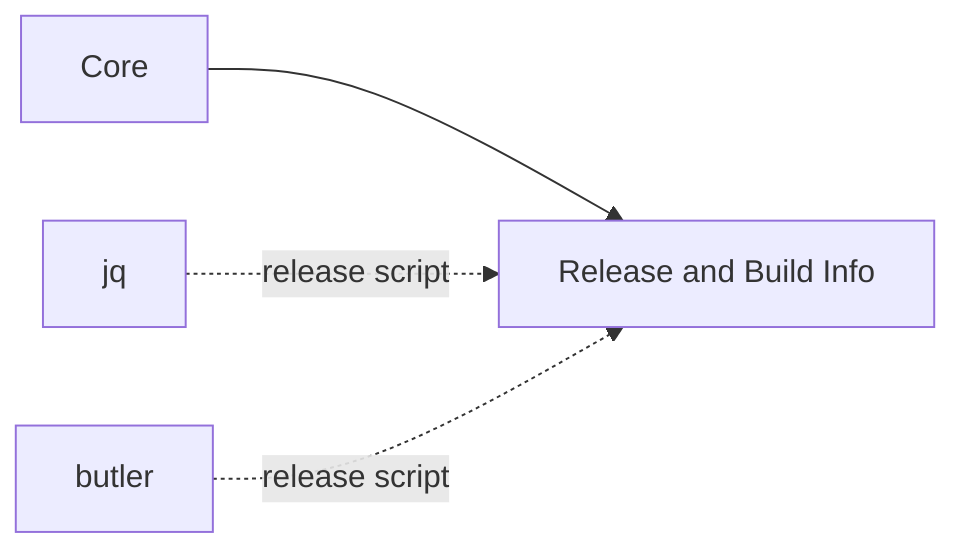

# Release and Build Info

The release script publishes an existing GameMaker export to itch.io. Export
and test the artifact before running it.

## Quickstart

Copy `tools/release/Release.command` beside the consumer `.yyp` and
`itch-config.json`, then make it executable. Double-click it to serve the HTML
export or publish a tested build. Serving runs `python3 -m http.server` directly.

```sh
./Release.command
```

The release script selects a configured platform, reads its export from
`Builds/<platform>`, asks for confirmation, and runs `butler push`. Game releases
require a clean `main`, update the generated and source versions, advance the
counter, commit that metadata, and create `releases/v<version>`. Pushing the
commit and tag is a separate confirmation. Prototypes use a timestamped upload
version without Git bookkeeping.

Install and authenticate Butler before publishing:

```sh
butler login
butler status username/project
```

The script searches `PATH` and `~/bin/butler`.

## Resources

- `tools/release/gmcu_release.sh`: Versions and publishes an existing export.
- `scripts/gmcu_build_info`: Runtime build metadata API.
- `objects/gmcu_o_build_info_label`: Optional bottom-right build label.

## Dependencies

| Dependency | Responsibility |
| --- | --- |
| [`Core`](core.md) | Supplies build configuration policy to runtime resources. |
| `jq` | Updates the release counter file. |
| `butler` | Publishes the selected export to itch.io. |

## Dependency Diagram



## Consumer Configuration

The normal consumer file is intentionally small:

```json
{
  "username": "studio",
  "project_name": "game",
  "platforms": ["html", "windows"]
}
```

Platform order supplies stable IDs starting at `1`. The script uses
`Builds/<platform>` and the platform name as the itch.io channel.

A reusable Prototype Lab configuration keeps diagnostic builds separate from
game releases:

```json
{
  "username": "studio",
  "project_name": "prototype-lab",
  "platforms": ["html"],
  "prototype": true
}
```

Prototype mode reads exports from `Builds/<platform>` and generates a
timestamped Butler version.

## API

Import or symlink:

- `scripts/gmcu_build_info`
- `objects/gmcu_o_build_info_label`

Initialize before analytics or UI creation:

```gml
gmcu_build_info_init({
    author: "Studio Name",
    copyright_start_year: 2024
});
global.build_number = gmcu_build_info_get_version();
```

Optional fields are `version_prefix`, `separator`, and `build_file`. Missing
`buildnumber.txt` falls back to `GM_version + "-dev"`.

The shared label preserves Fantasma's bottom-right black background and white
text. Consumer-specific author and date values are supplied at initialization.

| Item | Kind | Description |
| --- | --- | --- |
| `tools/release/gmcu_release.sh` | Shell script | Versions and publishes an existing export. |
| `gmcu_build_info_init(_options)` | Function | Initializes runtime build metadata. |
| `gmcu_build_info_get_version()` | Function | Returns the current build version string. |
| `gmcu_o_build_info_label` | Object | Optional bottom-right build label. |

Consumer repositories retain build paths, export artifacts, itch.io
destinations, version state, credentials, and presentation values.
